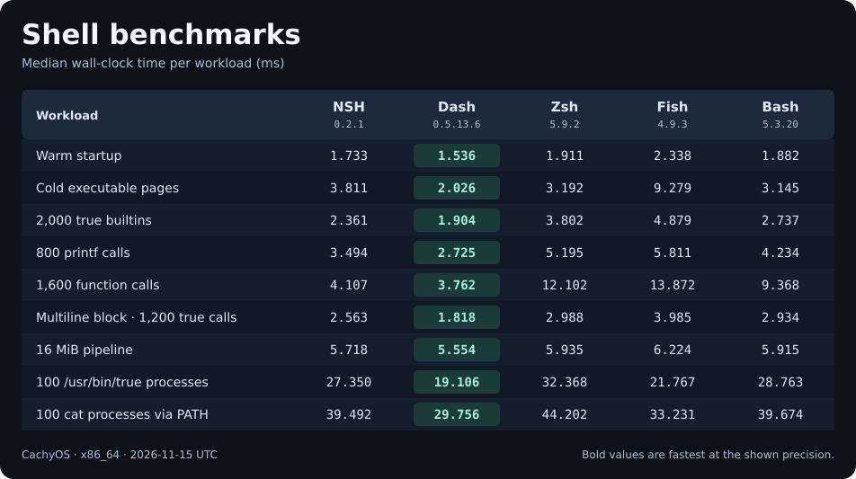

# NSH — Neo SH

**Just Vanilla SH.**

NSH — оболочка для Linux со своим интерпретатором на Rust. Обычные скрипты выполняются в POSIX-ориентированном режиме. В интерактивном сеансе Lua-плагины могут добавлять команды, менять приглашение и подсвечивать ввод. Поддерживаемый синтаксис перечислен в [справочнике POSIX](MANUALS/POSIX.md).

## Установка

Выберите пакет для своей системы и скачайте файл контрольных сумм `SHA256SUMS`. [Текущий релиз](https://github.com/AdrescorGiti/NSH/releases/latest)

| Дистрибутивы | Пакет | Установка |
|---|---|---|
| Arch Linux, CachyOS | `.pkg.tar.zst` | `sudo pacman -U -- ./nsh-0.2.1-2-x86_64.pkg.tar.zst` |
| Debian, Ubuntu и совместимые системы | `.deb` | `sudo apt install ./nsh_0.2.1-1_amd64.deb` |
| Fedora, RHEL-совместимые системы, ROSA | `.rpm` | `sudo dnf install ./nsh-0.2.1-1.x86_64.rpm` |

Перед установкой проверьте файл в каталоге загрузки.

~~~sh
sha256sum --ignore-missing -c SHA256SUMS
~~~

DEB и RPM используют один бинарник для x86-64-v1 с glibc от 2.17. Установка проверена на Debian, Ubuntu, Fedora, Red Hat UBI и ROSA Fresh. [Версии, зависимости и сборка пакетов](MANUALS/PACKAGE.md#debian-и-rpm-дистрибутивы)

Для сборки из исходников нужны Linux, Rust 1.85+ и системный C-компилятор.

~~~sh
cargo build --locked --release
target/release/nsh --vanilla -c 'printf "<%s>\n" "$@"' example one 'two words'
~~~

Запустите `nsh` после установки. Пакет сохраняет текущую login shell. Для режима POSIX используйте `nsh --posix`, для запуска без стартовых файлов — `nsh --vanilla`, для проверки с отключёнными Lua-плагинами — `nsh --no-plugins`.

## Плагины

~~~lua
nsh.command.register("hello", function(args)
    nsh.print("Hello, " .. (args[1] or "NSH"))
    return 0
end)
~~~

В [готовых примерах](examples/plugins/) есть подсветка, подсказки путей с принятием по Right Arrow и [Aurora Theme](MANUALS/AURORA_THEME.md) с настраиваемыми цветами и меню на Lua. Смотри [установку плагинов](MANUALS/PLUGINS.md), [туториал и Lua API](MANUALS/PLUGIN_API.md) и [настройки сеанса](MANUALS/CONFIG.md).

## Преимущества NSH

- **Скрипты и интерактивность в одной оболочке.** Собственный POSIX-ориентированный интерпретатор на Rust выполняет скрипты без загрузки Lua.
- **Lua меняет сам сеанс.** Плагины регистрируют команды, меняют текущий каталог и переменные, оформляют приглашение и добавляют меню, подсветку и подсказки. Команды Lua работают в процессе NSH и поддерживают перенаправления и пайплайны.
- **Исправимая конфигурация.** `nsh config check` проверяет синтаксис, ошибка при загрузке откатывает управляемые настройки профиля, а `nsh --no-plugins` позволяет запустить сеанс с отключёнными плагинами.

## Бенчмарки пяти оболочек

В 6 из 9 сценариев NSH заняла второе место по медиане. На 1600 вызовах функций NSH показала 4,11 мс, более чем вдвое быстрее Bash, Zsh и Fish в этом сценарии. Наименьшие медианы во всех девяти сценариях показал Dash.

[Версии, разброс и сырые замеры](MANUALS/benchmarks/current.md) · [Как повторить замеры](MANUALS/BENCHMARKS.md)

## Документация

[Все руководства (MANUALS)](MANUALS/) · [GitHub Wiki](https://github.com/AdrescorGiti/NSH/wiki) · [Текущий выпуск](CHANGELOG.md) · [Лицензия MIT](LICENSE)
